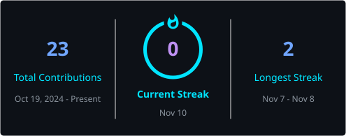

<!--
  GITHUB PROFILE README
  Username: lohith1976
  Theme: Cyberpunk / Futuristic Developer
-->

<div align="center">


<a href="https://git.io/typing-svg">

</a>

<br/><br/>


<br/><br/>

<a href="https://github.com/lohith1976">

</a>

</div>

---

## `> WHO_AM_I`

```yaml
name: Lohith Kumar
role: Computer Science Engineering Student
location: India

interests:
  - Full-Stack Development
  - Artificial Intelligence & Machine Learning
  - UI/UX Design
  - Software Engineering
  - Problem Solving
  - System Architecture

currently_focused_on:
  - Building practical software applications
  - Exploring AI-powered solutions
  - Developing interactive web experiences
  - Strengthening software engineering fundamentals

mindset: Learn | Build | Experiment | Improve
```

I'm a Computer Science Engineering student passionate about building technology that combines functionality, intelligence, and creativity.

I enjoy developing responsive web applications, experimenting with AI-powered solutions, designing intuitive interfaces, and transforming ideas into practical projects.

I believe in learning by building, experimenting with new technologies, and continuously improving my development skills.

---

## `> TECH_STACK`

### Programming Languages

<p align="left">


</p>

### Frontend Development

<p align="left">


</p>

### Backend Development

<p align="left">


</p>

### AI / Machine Learning

<p align="left">


</p>

### Databases

<p align="left">


</p>

### Design & Creative Tools

<p align="left">


</p>

### Developer Tools

<p align="left">


</p>

---

## `> FEATURED_PROJECTS`

### 01. DisruptionIQ — AI-Powered Supply Chain Intelligence

An intelligent supply-chain platform focused on disruption monitoring, risk analysis, downstream impact analysis, and recovery recommendations.

- Developed interactive operational dashboards using React and Vite.
- Built AI services using Python and FastAPI for disruption analysis, risk explanations, and recovery recommendations.
- Worked with Spring Boot REST APIs and Neo4j integration as part of the platform.

**Technologies:** React · Vite · Python · FastAPI · Spring Boot · Neo4j

### 02. AI Itinerary Planner

An AI-powered travel planning application that helps users generate personalized travel itineraries.

- Designed and developed responsive application interfaces.
- Focused on itinerary generation based on user preferences, budget, and schedule.
- Explored AI integration for personalized travel planning.

**Technologies:** React · AI Integration · Frontend Development · UI/UX

### 03. MALE UAV Engine Digital Twin & Predictive Maintenance Dashboard

A dashboard for monitoring UAV engine health, telemetry, and maintenance-related information.

- Designed and developed the React frontend and user interface.
- Created interactive views for telemetry, sensor data, engine health, diagnostics, and alerts.
- Built visualizations to present engine parameters and system health.

**Technologies:** React · Python · Machine Learning · Data Visualization · UAV Simulation

### 04. AI-Powered RPG Game

An interactive role-playing game concept combining game design and AI-powered experiences.

- Designed the overall game experience, UI/UX, and gameplay interfaces.
- Developed the frontend using React.
- Focused on gameplay interactions, visual consistency, and user experience.

**Technologies:** React · Phaser 3 · Tailwind CSS · Zustand

---

## `> GITHUB_STATISTICS`

<div align="center">


<br/><br/>



</div>

---

## `> GITHUB_STREAK`

<div align="center">



</div>

---

## `> CONTRIBUTION_GRAPH`

<div align="center">


</div>

---

## `> CONTRIBUTION_SNAKE`

<div align="center">


</div>

---

## `> CONNECT_WITH_ME`

<div align="center">

<a href="https://www.linkedin.com/in/lohithkumar196">

</a>

<a href="mailto:rit.lohith@gmail.com">

</a>

<a href="https://github.com/lohith1976">

</a>

<br/><br/>

### `BUILDING THE FUTURE, ONE COMMIT AT A TIME.`

<br/>


</div>
